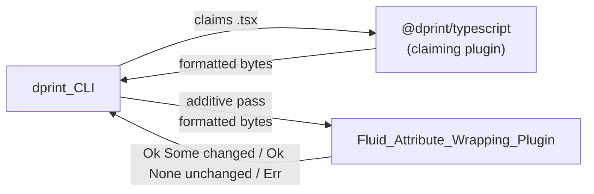
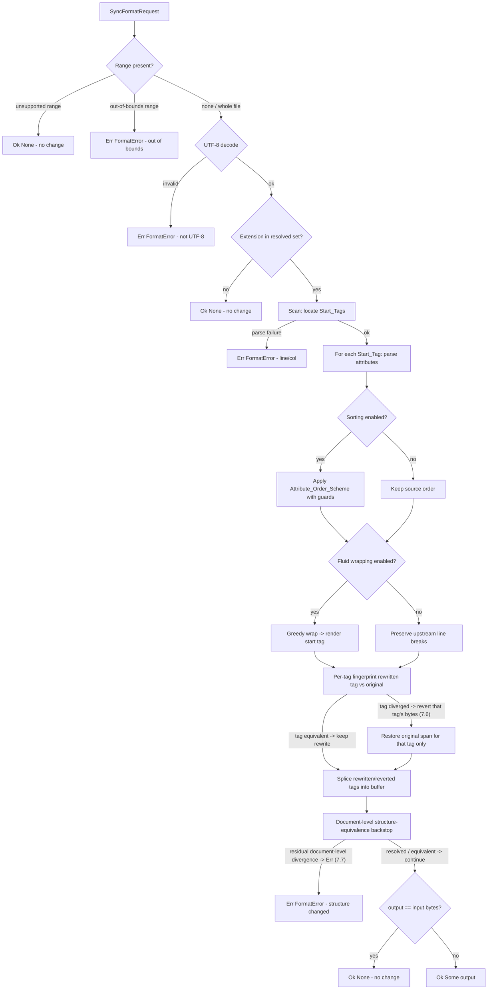
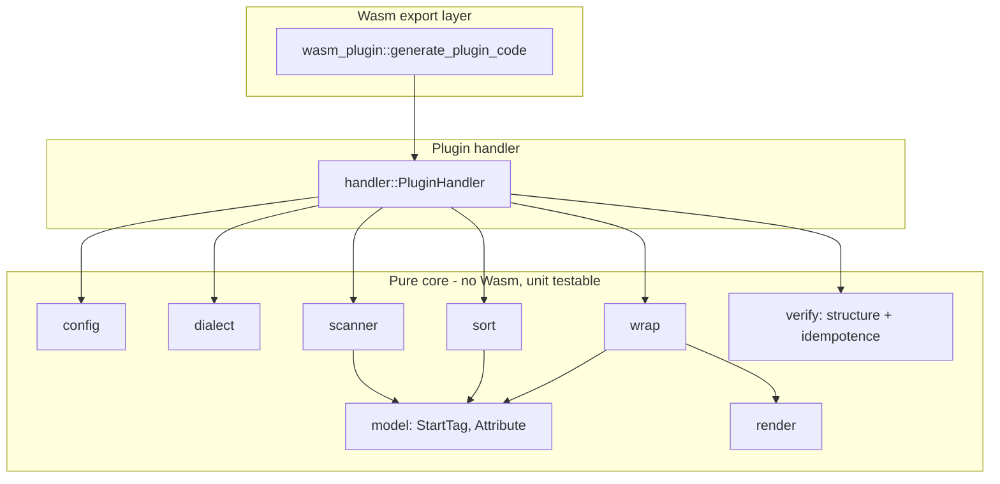
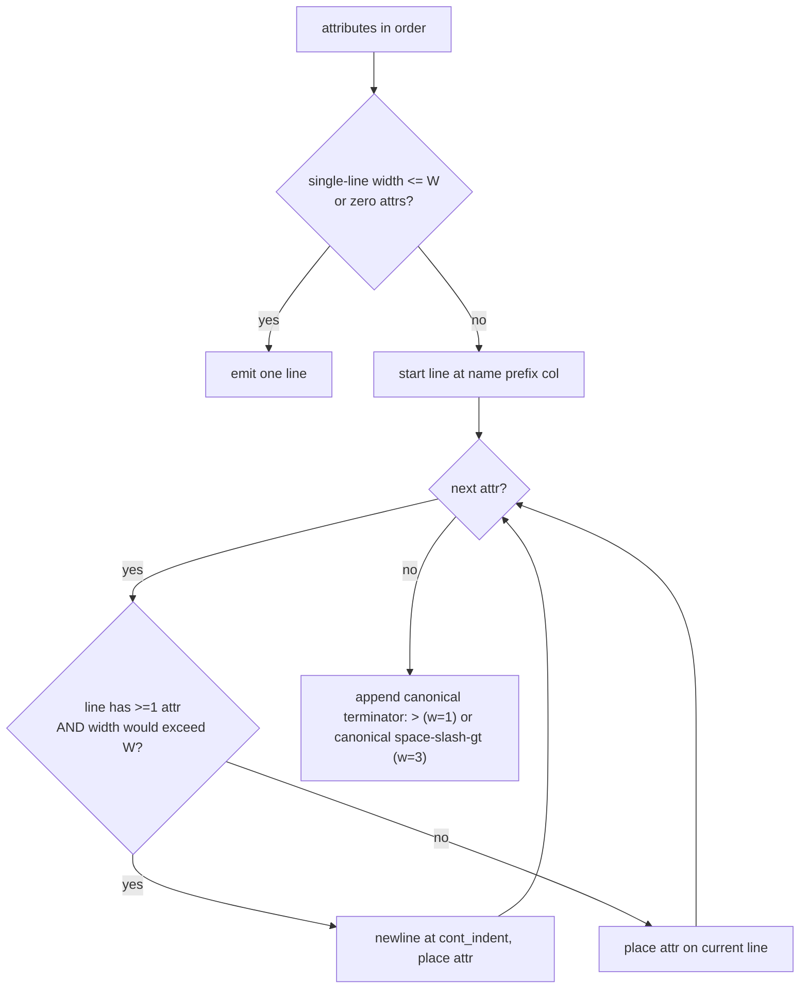

# Design Document

## Overview

The Fluid_Attribute_Wrapping_Plugin is a sandboxed WebAssembly plugin for [dprint](https://dprint.dev/) that implements the dprint Wasm plugin interface at Schema Version 4 using the `dprint-core` crate (`wasm` feature), compiled to a single `wasm32-unknown-unknown` module. It runs as an **additive** post-processing pass after upstream plugins such as `npm:@dprint/typescript` and `dprint-plugin-markup`, and performs exactly two transformations on the start tags of markup elements:

1. **Fluid (greedy) attribute wrapping** — pack as many attributes as fit within the line width on each line, then continue on the next line (Requirement 4), replacing the all-or-nothing wrapping that mainstream formatters emit.
2. **Optional attribute sorting** — reorder attributes according to a named `Attribute_Order_Scheme`, with hard safeguards that preserve any ordering that affects rendered or runtime behavior (Requirement 5).

The central design constraint, which drives every major decision below, is **safety through minimalism**: the plugin must change *only* the whitespace and attribute order inside start tags, preserving everything else byte-for-byte (Requirements 3.6, 7.4), guaranteeing idempotence (Requirement 8), and refusing to emit output whose markup structure differs from the input (Requirements 7.5, 7.6). This is the same "adjust only whitespace, never reject or rewrite" philosophy that underpins lossless formatters such as [`lax`](https://github.com/bartlomieju/lax) (which powers `deno fmt`). Content was rephrased for compliance with licensing restrictions.

### Design Principles

- **Minimal surface of change.** The plugin locates start tags, rewrites only the bytes inside each start tag, and splices the rewritten tag back into the original buffer. Nothing between start tags is ever touched.
- **Verify, then commit.** Every format pass is validated against the input (structure equivalence + idempotence) before it is returned. On any mismatch the plugin returns a `Format_Error` and the original bytes are preserved.
- **Fail safe, never corrupt.** Parse failures, unsupported ranges, non-UTF-8 input, and self-check failures all resolve to "no change" or a structured error — never a partially rewritten file.
- **Deterministic.** Given identical input and resolved configuration, output is byte-identical across runs (Requirements 5.9, 8).

### Requirements Traceability Summary

| Requirement | Primary design element |
|---|---|
| 1 Interface conformance | `PluginHandler` + `generate_plugin_code!` (Architecture, Components) |
| 2 Post-processing / additive | `FileMatchingInfo.additive = true`, UTF-8 guard, no-change signalling |
| 3 Dialects | `Dialect` enum, extension → dialect resolution, dialect enablement |
| 4 Fluid wrapping | `wrap` module greedy algorithm |
| 5 Attribute sorting | `sort` module + `AttributeOrderScheme` with behavior-preservation guards |
| 6 Configuration | `config` module, `Configuration`, diagnostics, JSON schema |
| 7 Error handling | `scanner` structure-equivalence check, range validation, `FormatError` |
| 8 Idempotence | post-format self-check, stable sort, canonical spacing |
| 9 Quality / testing | crate layout, clippy config, `proptest` suite |

## Architecture

### Runtime Position



Because the plugin reports `additive: true` in its `FileMatchingInfo`, the dprint_CLI runs it in addition to the plugin that claims each matched file, feeding it the already-formatted bytes (Requirements 2.1, 2.2). When no upstream plugin claims the file, the CLI still invokes the additive plugin on the original bytes, and the same transformation pipeline applies (Requirement 2.3).

### Format Pipeline



The above is a single `format_once` pass: it ends at the per-tag fingerprint check and the document-level backstop, and returns a candidate (or an error). The **idempotence self-check is not shown inside this pass** — the public `format_document` runs `format_once` a second time on the candidate and asserts a byte-for-byte fixed point (see Idempotence Strategy). Structure-equivalence is enforced **per tag first, document-level second**:

- **Per-tag fingerprint (Requirement 7.6).** Each rewritten Start_Tag is fingerprinted individually — its structural signature (element name, self-closing flag, and the ordered/multiset of attribute name→raw-value pairs) is captured BEFORE and AFTER its own rewrite. After rewriting a tag, the tag-local fingerprint of the rewrite is compared against the original tag's fingerprint. If that specific rewritten tag diverges, **only that tag's rewrite is discarded** — its original bytes are restored (the original span is emitted) — and the scan continues. Every other tag keeps its valid rewrite. This is a per-tag safe no-op.
- **Document-level backstop (Requirement 7.7).** After all per-tag reverts, a whole-document structure-equivalence check runs as a final backstop. If a document-level divergence still remains — one that could not be localized to, and resolved by, reverting individual tags — `format_once` returns a `Format_Error` and the input is left unchanged.

Per-tag attribution deliberately shrinks the blast radius: a divergence that *can* be localized to one tag costs only that tag's rewrite, so an unrelated real bug elsewhere in the same file still surfaces as a loud 7.7 `Format_Error` rather than being masked by a file-wide no-op. The per-tag confidence skip (layer 1, Requirement 4.9) remains the primary safeguard for tags the scanner declines to touch at all; the per-tag fingerprint check here is the backstop for tags that *were* rewritten.

### Layered Design



The Wasm boundary is a thin shell generated by the macro. All logic lives in a pure core that is compilable and testable on the host target (`cargo test` on the native target), which keeps the property-based test suite fast and independent of the Wasm runtime (Requirement 9).

### Parsing Strategy (Design Decision 1)

**Decision: implement a purpose-built, start-tag-only scanner rather than reusing a full markup/JSX parser.**

Three candidate approaches were evaluated:

1. **Reuse `markup_fmt`** (the parser/formatter behind `dprint-plugin-markup`, covering HTML/Vue/Svelte/Astro). Rejected as the primary engine: `markup_fmt` is a *reformatter* — it re-emits whole documents with its own whitespace and wrapping policy, which conflicts with Requirements 3.6 and 7.4 (preserve everything outside start tags, and dynamic/spread attributes, byte-for-byte) and makes byte-level idempotence against upstream output (Requirement 8) impractical. It would also re-impose all-or-nothing wrapping, the very behavior this plugin exists to override.
2. **Reuse `swc_ecma_parser` for JSX/TSX.** Rejected as the primary engine: it produces a full span-annotated ECMAScript AST, but (a) it only covers JS/TS/JSX, not HTML/Vue/Astro/Svelte, so a second engine would still be required; (b) it substantially increases the Wasm binary size and compile complexity; and (c) using a full JS AST invites rewriting expression contents, which violates the byte-for-byte preservation of dynamic/spread attributes.
3. **Purpose-built start-tag scanner (chosen).** A single, small, dialect-parameterized scanner that walks the UTF-8 buffer, skips regions that must never be reinterpreted (text nodes, comments, CDATA, `<script>`/`<style>` bodies, raw-text elements, doctype/processing instructions, template interpolations), locates element **start tags**, and tokenizes *only* the attribute list of each start tag.

**Justification.** The transformation is intentionally narrow: only whitespace inside start tags and attribute order change. A scanner that understands just enough structure to (a) reliably find start-tag boundaries and (b) split a start tag into `name` + ordered `attributes` + `self-closing?` is far simpler to make correct and byte-faithful than a full parser, produces a dramatically smaller Wasm module, and makes the "preserve everything else byte-for-byte" guarantee structural rather than best-effort. This mirrors the lossless, whitespace-only approach of `lax`/`deno fmt`. Content was rephrased for compliance with licensing restrictions.

**How start tags are located and isolated.** The scanner is a state machine over byte offsets. It tracks a small set of "opaque" regions it must copy verbatim and never scan for tags:

- Markup comments (`<!-- ... -->`), CDATA (`<![CDATA[ ... ]]>`), doctype/declarations (`<!...>`), and processing instructions (`<? ... ?>`).
- Raw-text / escapable-raw-text element bodies in HTML (`<script>`, `<style>`, `<textarea>`, `<title>`): once such a start tag is consumed, everything up to the matching end tag is opaque.
- Dialect template regions that are not element markup: Vue/Astro/Svelte interpolations and directive expressions, and framework fenced regions (e.g. Astro frontmatter `---`). Inside a start tag these appear as attribute *values* or spread attributes and are handled by the attribute tokenizer; outside a start tag they are opaque text.

JSX/TSX child-position expression containers (`{ ... }`) are handled differently: the scanner **walks into** them rather than treating them as opaque, because genuine JSX elements routinely live inside `.map()` callbacks, ternaries, and `&&`/`||` conditionals (`{rows.map(r => <Row key={r.id} />)}`). Inside a container the bytes are ordinary JS/TS expression text subject to the same expression-position gate described below, so a genuine JSX `<` is still recognized while a TypeScript generic or `<` operator is rejected. Each active container tracks its own interior `{`/`(`/`[` nesting (and the surrounding string/template/regex/comment lexical state) so that a `}` buried in a string, template, regex, comment, or nested bracket never closes the container early; `{/* ... */}` JSX comments are the natural sub-case of this. Walking in (rather than skipping the container as opaque) is what lets genuine JSX elements produced from `.map()` callbacks, ternaries, `&&`/`||` conditionals, and nested containers be recognized and formatted — fluid-wrapped and, where enabled, sorted — identically to the same element written outside any container, which is overwhelmingly where idiomatic React places its elements. The expression-position gate is what keeps this safe: a `<` inside the container that follows a value producer (a TypeScript generic or `<` operator) is still rejected, so entering the container does not reintroduce the generics corruption.

When the scanner encounters `<` followed by a tag-name start character (dialect-specific: ASCII letter for HTML; letter/`_`/`$`, and for JSX member/namespace forms `.`/`:`, for JSX/TSX), it enters start-tag scanning and consumes up to the matching `>` that closes the tag, correctly skipping `>` characters that appear inside quoted attribute values and inside balanced `{...}`/`(...)` expression regions. The exact byte span `[tag_start, tag_end)` of the start tag is recorded. Only that span is rewritten; the bytes before and after are preserved exactly (Requirements 3.6, 4.6).

**Expression-position gate for JSX/TSX (`<` is not always a tag).** For HTML a `<` followed by a name-start character begins a tag. For JSX/TSX that first-character rule is necessary but not sufficient: `Array<Task>`, `useState<...>`, `axios.get<...>`, and `a < b` are TypeScript generic argument lists or comparison operators, not JSX elements, and must be left byte-for-byte unchanged. The scanner therefore gates `<`-as-start-tag on a sound, **drift-proof** JSX context model in addition to the name-start rule. It maintains a running classification of the most recent significant (non-whitespace, non-comment) token at the current position — not a nesting counter, but a pure "what did I last see" recomputed continuously from the bytes consumed. A `<` begins a JSX element only when the preceding significant token is an **expression introducer** (start of input, or after `= ( , { : ? & | ! ; return yield await =>`, or the `>`/end tag of a parent element — i.e. child position); when the preceding token is a **value producer** (an identifier character, `)`, `]`, or a string/number/template literal) the `<` is a TypeScript generic or less-than and is skipped as ordinary non-tag bytes. Because the classifier is recomputed from the bytes rather than accumulated across the file, a fragment (`<>`…`</>`), a self-closing tag, or a skipped generic cannot make it drift and silently disable the gate: a top-level `useState<Array<Task>>` after arbitrary earlier JSX is still correctly seen in value position and left alone. Nested generics are preserved in full because each inner `<` is likewise in value position and every `>` is ordinary text. This gate is applied to the JSX/TSX dialects only — the same dialects that walk into child containers — so it doubles as the "apply the gate" marker; the markup dialects (HTML, Vue, Astro, Svelte) keep the plain first-character rule, where a `<` after text is an ordinary adjacent start tag (`<a>text<b>`) and the preceding-token context is not consulted.

**Attribute tokenization.** Within a start-tag span, the tokenizer produces an ordered list of `Attribute` tokens plus the exact inter-attribute and surrounding whitespace it replaces. It recognizes:

- **Plain** boolean attributes: `disabled`.
- **Name-value** attributes: `name = value` where the value is a quoted string (`"..."`, `'...'`), an unquoted HTML value, or a braced expression (`class={x}`, `:class="..."`, `v-if="x"`, `on:click={...}`, `client:load`, `{#if}`-adjacent forms are opaque text, not attributes).
- **Dynamic / spread** attributes: `{...props}`, `{...rest}` (JSX), `v-bind="obj"`, `{...spread}` (Svelte/Astro). These are captured as a single opaque token whose raw byte slice is preserved exactly and never reformatted internally (Requirement 7.4). Their value is never parsed as an expression.

Each `Attribute` retains its **raw byte slice** (`name` through end of `value`, verbatim). Rendering never reconstructs an attribute from parts; it re-emits the captured raw slice and only changes the whitespace *between* attributes and the leading whitespace of continuation lines. This makes attribute-value preservation structural (Requirements 4.6, 5.3, 7.4).

**Structure-equivalence safety check (per-tag first, document-level backstop).** Structure equivalence is enforced at two granularities, in order:

1. **Per-tag fingerprint (Requirement 7.6).** Each rewritten Start_Tag is fingerprinted *individually* — its structural signature is `(element name, self-closing flag, ordered/multiset of attribute name→raw-value pairs)`, captured both BEFORE and AFTER that tag's own rewrite. Immediately after rewriting a tag, the engine compares the rewrite's tag-local fingerprint against the original tag's fingerprint under the equivalence relation of Requirement 7.5 (disregarding only whitespace the formatter introduced/removed inside the start tag). If that specific rewritten tag diverges, the engine **discards only that tag's rewrite**, restoring the tag's original bytes (emitting the original span) and continuing — a per-tag safe no-op. All other tags keep their valid rewrites. When sorting is enabled, a tag's attribute order is compared as a multiset (order-insensitive) except for the mutually behavior-affecting attributes, whose relative order must match (Requirement 5.5).
2. **Document-level backstop (Requirement 7.7).** After all per-tag reverts are applied, the scanner is run again over the whole *output* buffer to extract the document structural fingerprint — the ordered sequence of `(element name, self-closing flag, multiset of attribute name→raw-value pairs)` plus the verbatim text between tags — and this is compared to the input document fingerprint under the same Requirement 7.5 equivalence relation. If a divergence **still** remains — one that could not be localized to, and resolved by, reverting individual tags — the engine returns a `Format_Error` and leaves the input unchanged (Requirement 7.7). The document-level backstop additionally enforces an **angle-bracket-conservation invariant**: the total count of `<` and the total count of `>` over the *whole* output buffer must equal those over the whole input buffer. Because the plugin's transform only ever adjusts whitespace and attribute order inside genuine start tags, it never adds or removes a `<`/`>` anywhere, so these counts are an invariant of every legitimate wrap/sort; the invariant is trivially whitespace- and reorder-insensitive. This closes a self-check blind spot: a scanner misread that drops a `<` or `>` (for example mistaking a TypeScript generic for a tag and dropping a bracket) changes the raw-buffer count, so the divergence is caught even when the same misread occurs symmetrically on both the input and the output scan — a case the fingerprint comparison alone cannot see because the dropped delimiters fall inside the misrecognized tag span on both sides. The check is `O(n)`, allocation-free, and dialect-agnostic, so it strengthens the self-check for every dialect at negligible cost; on failure it drives the same per-tag revert (Requirement 7.6) or document-level `Format_Error` (Requirement 7.7).

Per-tag attribution shrinks the blast radius of a mismatch: a localizable divergence costs only the offending tag's rewrite, so an unrelated genuine bug in the same file still surfaces as a loud 7.7 `Format_Error` rather than being masked by discarding the whole file's work.

#### JSX/TSX attribute-expression limits and graceful degradation

**Honest scope of the hand-rolled scanner.** Fully delimiting a JSX/TSX braced attribute expression (`attr={ ... }`) is, in the general case, equivalent to running a JavaScript lexer: the expression body may contain string literals in all three quote forms (`'...'`, `"..."`, and template literals), template literals with nested `${ ... }` interpolations that themselves contain arbitrary expressions, regular-expression literals, and line (`// ...`) and block (`/* ... */`) comments, as well as nested object and arrow-function bodies with their own braces and parentheses. Naive balanced-brace/paren counting misfires on constructs such as `{ a: "}" }` (a closing brace inside a string literal), a `>` appearing inside a string, or a regex literal that contains `/>` or `}`. The scanner is deliberately *not* a JavaScript lexer, so it does not promise to delimit every such expression.

**Scanner confidence model.** While tokenizing a start tag's attribute list, the scanner tracks enough lexical state — string-literal state across the three quote forms, template-literal and nested `${}` nesting, regex-literal context, and line/block comment state — to delimit the common cases correctly. When it reaches a braced attribute expression it cannot delimit with full confidence (for example because the lexical state becomes ambiguous or nesting cannot be resolved with certainty), it marks that attribute as a `Complex_Expression_Attribute` and, consequently, marks the **whole start tag** as *not-confidently-rewritable*. Confidence is a property of the entire tag: a single uncertain attribute poisons the tag.

The same confidence loss applies to a **component-with-generics head** such as `<EditableList<SearchEngineDomain>>` or `<Select<Array<number>> ...>`. Here the opening `<` is a genuine JSX `<` (it is in expression position), but the element name is immediately followed by a generic `<` that the scanner cannot delimit without a TypeScript type parser. A `<` encountered in the attribute region (after the tag name, before the tag terminator) is treated as a confidence loss: the whole start tag is marked *not-confidently-rewritable* and left byte-for-byte unchanged (a per-tag no-op, Requirement 4.9), rather than dropping its inner `<`. The scanner still records the tag's span so the walk resumes correctly after it. This keeps the plugin honest about the hand-rolled scanner's limits: it declines to rewrite rather than guess.

**Two layers of graceful degradation.** Degradation is enforced at two distinct layers, and the design keeps them explicit:

1. **Per-tag confidence skip (Requirements 4.9, 7.6).** A start tag that the scanner judges *not-confidently-rewritable* is left **byte-for-byte unchanged** — a per-tag no-op. The scanner emits the tag's original span verbatim and never attempts wrapping or sorting on it. This is the primary, cheap safeguard and handles the `Complex_Expression_Attribute` case directly (Requirement 4.9): such tags are never rewritten, so they never reach the fingerprint check.
2. **Per-tag fingerprint backstop (Requirement 7.6), then document-level backstop (Requirement 7.7).** For tags that *were* rewritten, each rewrite is fingerprinted individually against its own original (see "Structure-equivalence safety check"). If a specific rewritten tag diverges, **only that tag's rewrite is discarded** and its original bytes are restored — a per-tag safe no-op for that Start_Tag, while every other tag keeps its valid rewrite. After all per-tag reverts, a whole-document structure-equivalence check runs; a residual document-level divergence that could not be localized to and resolved by reverting individual tags yields a `Format_Error` (Requirement 7.7).

**Per-tag attribution instead of a file-level flag.** There is no file-level `any_tag_confidence_flagged` boolean and no file-wide classifier. Divergence is attributed at the granularity of the individual rewritten tag by comparing each tag's before/after fingerprint directly, which is concrete and deterministic and does not require re-attributing a whole-file mismatch to a specific expression after the fact. The per-tag confidence skip (layer 1) prevents most uncertainty from ever producing a rewrite; the per-tag fingerprint check (layer 2) catches any rewrite that nonetheless diverged and reverts exactly that tag.

**Rationale.** Per-tag attribution keeps the safety mechanism precise and keeps the loud 7.7 signal meaningful. A divergence the engine can localize to one tag is resolved by reverting that single tag (a safe no-op for it), so the rest of the file's valid rewrites are retained and an *unrelated* real bug in the same file is not masked — it still produces a residual document-level divergence and surfaces as a 7.7 `Format_Error`. This shrinks the blast radius compared with a file-wide "discard everything" no-op: only genuinely un-localizable divergence reaches the loud failure path, and only the specific uncertain tags are silently reverted.

Note that the two layers compose, with distinct roles: the **per-tag confidence skip remains the primary safeguard** (it prevents most uncertainty from ever producing a rewrite), and the **per-tag fingerprint check is the backstop** for rewrites that slip through, with the document-level check as the final guard for any residual, un-localizable divergence.

**Worked example.** Consider the JSX start tag:

```jsx
<button onClick={() => x > 1 ? a : b} style={{ width: '>' }}>
```

Both attribute values contain characters that defeat naive counting: `onClick`'s body has a bare `>` (a comparison operator, not a tag terminator) and a `?:` expression; `style`'s value is a nested object literal whose string contains a `>` character. The scanner proceeds one of two ways, both safe:

- If its lexical tracking resolves both braced regions with full confidence (string state correctly absorbs the `'>'`, brace nesting for `{{ ... }}` balances, and the bare `>` is recognized as inside a braced expression rather than the tag terminator), it delimits the start tag normally and may wrap/sort it.
- If at any point it cannot be certain where a braced expression ends, it marks the offending attribute as a `Complex_Expression_Attribute`, flags the whole tag as not-confidently-rewritable, and **skips the tag** — emitting it exactly as received (Requirement 4.9).

In neither case does the scanner guess: it either confidently delimits the tag or leaves it untouched.

## Components and Interfaces

All public types are strictly typed; no `unwrap()`/`expect()` on fallible paths in production code; errors are modeled with `Result` and a dedicated error enum. The crate is `#![deny(warnings)]`-clean and clippy-clean (Requirement 9.2).

### `wasm_plugin` (Wasm export shell)

Compiled only for `wasm32-unknown-unknown` under the `wasm` feature. It contains a single line:

```rust
// src/wasm_plugin.rs
#[cfg(all(target_arch = "wasm32", target_os = "unknown"))]
dprint_core::generate_plugin_code!(PluginHandler, PluginHandler::default());
```

The macro emits all required Schema Version 4 exports (`dprint_plugin_version_4`, `register_config`, `get_config_diagnostics`, `get_resolved_config`, `get_config_file_matching`, `get_plugin_info`, `get_license_text`, `format`, `format_range`, shared-buffer helpers) (Requirements 1.1, 1.6). API confirmed against the official [dprint Wasm plugin development guide](https://github.com/dprint/dprint/blob/main/docs/wasm-plugin-development.md). Content was rephrased for compliance with licensing restrictions.

### `handler::PluginHandler`

Implements `dprint_core::plugins::SyncPluginHandler<Configuration>`.

```rust
use dprint_core::configuration::{ConfigKeyMap, GlobalConfiguration};
use dprint_core::plugins::{
    CheckConfigUpdatesMessage, ConfigChange, FileMatchingInfo, FormatError, FormatResult,
    PluginInfo, PluginResolveConfigurationResult, SyncFormatRequest, SyncHostFormatRequest,
    SyncPluginHandler,
};

#[derive(Default)]
pub struct PluginHandler;

impl SyncPluginHandler<Configuration> for PluginHandler {
    fn plugin_info(&mut self) -> PluginInfo { /* Requirement 1.2 */ }
    fn license_text(&mut self) -> String { /* Requirement 1.3 */ }
    fn resolve_config(
        &mut self,
        config: ConfigKeyMap,
        global_config: &GlobalConfiguration,
    ) -> PluginResolveConfigurationResult<Configuration> { /* Requirement 6 */ }
    fn check_config_updates(
        &self,
        _message: CheckConfigUpdatesMessage,
    ) -> Result<Vec<ConfigChange>, FormatError> { Ok(Vec::new()) }
    fn format(
        &mut self,
        request: SyncFormatRequest<Configuration>,
        _format_with_host: impl FnMut(SyncHostFormatRequest) -> FormatResult,
    ) -> FormatResult { /* delegates to engine::format_document */ }
}
```

Responsibilities and requirement mapping:

- `plugin_info` returns a non-empty name (`env!("CARGO_PKG_NAME")`), a `MAJOR.MINOR.PATCH` version (`env!("CARGO_PKG_VERSION")`), the config key `"fluidAttributeWrapping"`, an `https://` help URL, and an `https://` `config_schema_url` (Requirement 1.2).
- `license_text` returns the embedded license (`include_str!("../LICENSE")`), non-empty (Requirement 1.3). The `LICENSE` file MUST be non-empty from the very first build so that Requirement 1.3 ("non-empty license text") holds even in early builds; it is seeded with at least placeholder license text rather than left empty.
- `resolve_config` builds the `Configuration`, collects `Configuration_Diagnostic`s, and returns `FileMatchingInfo { file_extensions, file_names: vec![], additive: true }` with extensions derived from the resolved config (Requirements 1.4, 2.1, 3). The `generate_plugin_code!` machinery returns the "no resolved configuration available" error if file-matching is requested before `register_config` (Requirement 1.5); the handler does not mutate any previously resolved config on that path.
- `format` performs range validation, UTF-8 decoding, extension/dialect gating, and delegates the transformation to the pure `engine` (Requirements 2, 3, 7). `format_with_host` is unused — this plugin never re-dispatches to other plugins.
- `check_config_updates` returns an empty `Vec` today (no config migrations yet); this is the hook where future `Attribute_Order_Scheme` migrations (e.g. renaming or splitting schemes) would be emitted as `ConfigChange`s.

### `engine::format_document` and `engine::format_once` (orchestration, pure)

```rust
/// Performs exactly ONE formatting pass: scan, sort, wrap/render, splice, and
/// the per-tag structure-equivalence self-check (Requirements 7.6, 7.7). It does
/// NOT perform the idempotence self-check and NEVER calls itself.
fn format_once(
    file_path: &Path,
    input: &[u8],
    range: Option<Range<usize>>,
    config: &Configuration,
) -> Result<Vec<u8>, EngineError>;

/// Public entry point. Calls `format_once(input)` once to obtain a candidate,
/// then performs the idempotence self-check by calling `format_once(candidate)`
/// exactly one more time and asserting the result equals the candidate
/// byte-for-byte (Requirements 8.2, 8.3). Returns `Ok(Some(bytes))` on change,
/// `Ok(None)` on no change, or `Err` on error.
pub fn format_document(
    file_path: &Path,
    input: &[u8],
    range: Option<Range<usize>>,
    config: &Configuration,
) -> Result<Option<Vec<u8>>, FormatError>;
```

**Recursion/termination seam.** The pipeline is split into two functions so that the idempotence self-check cannot recurse:

- `format_once` performs exactly one pass — scan, sort, wrap/render, splice, and the per-tag structure-equivalence self-check — and returns the candidate bytes (or an `EngineError`). `format_once` is **non-recursive**: it never calls itself and never calls `format_document`.
- `format_document` calls `format_once(input)` to produce the candidate, then performs the idempotence check by calling `format_once(candidate)` **one** more time and asserting `format_once(candidate) == candidate` (a byte-for-byte fixed point). If they are not equal, it returns a `Format_Error` indicating idempotence was not achieved and leaves the original input unchanged (Requirement 8.3); otherwise it maps the candidate to `Ok(Some(..))` or `Ok(None)`.

Because `format_once` is non-recursive and `format_document` calls `format_once` exactly twice (never itself), total work is bounded to exactly two `format_once` passes and termination is **structural** rather than dependent on the input converging. This is the main orchestration seam and the entry point exercised by unit and property tests on the host target.

### `dialect`

```rust
pub enum Dialect { Html, Jsx, Tsx, Vue, Astro, Svelte }

impl Dialect {
    /// Case-insensitive extension → dialect, honoring enablement flags.
    pub fn from_extension(ext: &str, config: &Configuration) -> Option<Dialect>;
    pub fn scanner_profile(&self) -> ScannerProfile; // tag-name rules, opaque regions, attr forms
}
```

HTML/JSX/TSX are always supported (Requirements 3.1, 3.2). Vue/Astro/Svelte are only returned when enabled in config; when disabled, `from_extension` returns `None` so the file is preserved byte-for-byte (Requirements 3.3, 3.4). Extensions not in the resolved set also yield `None` (Requirement 3.5).

### `scanner`

```rust
pub struct ScannedTag<'a> {
    pub span: Range<usize>,       // byte range of the full start tag in the buffer
    pub name: &'a str,
    pub self_closing: bool,
    pub attributes: Vec<Attribute<'a>>,
    pub open_col: usize,          // display column of '<', from line start, tab=indent_width model
    pub base_indent_col: usize,   // leading-whitespace column of the tag's physical line
}

pub fn scan_start_tags<'a>(src: &'a str, profile: &ScannerProfile)
    -> Result<Vec<ScannedTag<'a>>, ParseFailure>;

pub struct ParseFailure { pub line: usize, pub column: usize, pub message: String }
```

`scan_start_tags` returns the ordered start tags with their exact spans, or a `ParseFailure` carrying line/column (Requirement 7.1). It never allocates copies of attribute values — all slices borrow from `src`.

**Enumerated hard parse-failure triggers (Requirement 7.1).** The scanner produces a `ParseFailure` only for the following end-of-input truncation conditions, so that Requirement 7.1 and Property 20 are concrete and testable rather than dead code:

- An **unterminated start tag**: a `<name` with no closing `>` reached before end of input.
- An **unterminated quoted attribute value**: an opening `"` or `'` with no matching closing quote before end of input.
- An **unterminated braced expression region**: an opening `{` of a JSX/TSX attribute expression with no confidently matched close before end of input.
- An **unterminated opaque region** at end of input: a comment (`<!-- ...`), CDATA (`<![CDATA[ ...`), or raw-text element body (`<script>`, `<style>`, `<textarea>`, `<title>`) with no matching terminator before end of input.

All **other** ambiguous constructs are handled leniently — treated as opaque text, or, for a start tag the scanner cannot confidently delimit, resolved by the per-tag confidence-skip no-op described above (Requirement 4.9) — rather than raising a hard failure. Hard failures are therefore limited to the enumerated truncation cases above; the scanner never fails on merely unusual-but-complete markup.

### `sort`

```rust
pub fn sort_attributes<'a>(attrs: &[Attribute<'a>], scheme: &AttributeOrderScheme)
    -> Vec<Attribute<'a>>;
```

Applies the scheme with behavior-preservation guards (Design Decision 2, Requirement 5). Pure and total: on a structurally valid scheme it always returns a permutation of the input; an invalid scheme is rejected earlier at config resolution (Requirement 5.7) so this function always receives a valid scheme.

### `wrap` and `render`

```rust
pub fn render_start_tag(tag: &ScannedTag, config: &Configuration, newline: Newline) -> String;
```

Given a scanned tag and config, produces the replacement text for the tag span, applying greedy wrapping (Design Decision 3) when enabled, or preserving upstream line breaks when disabled (Requirement 4.8). `Newline` is detected from the surrounding buffer so output line endings match the file (Requirement 8.1).

### `verify`

```rust
/// Tag-local fingerprint: (name, self_closing, attribute name→raw-value pairs).
pub fn tag_fingerprint(tag: &ScannedTag) -> TagFingerprint;
/// Whole-document fingerprint: ordered tag fingerprints + verbatim inter-tag text.
pub fn structural_fingerprint(src: &str, profile: &ScannerProfile)
    -> Result<Fingerprint, ParseFailure>;
/// Per-tag equivalence used to decide whether a single rewrite must be reverted (Req 7.6).
pub fn tag_fingerprints_equivalent(before: &TagFingerprint, after: &TagFingerprint, sorting: bool) -> bool;
/// Document-level backstop comparison (Req 7.7).
pub fn fingerprints_equivalent(input: &Fingerprint, output: &Fingerprint, sorting: bool) -> bool;
```

`tag_fingerprint` + `tag_fingerprints_equivalent` drive the **per-tag** check: after a tag is rewritten, its before/after fingerprints are compared and the rewrite is reverted for that tag alone if they diverge (Requirement 7.6). `structural_fingerprint` + `fingerprints_equivalent` drive the **document-level backstop** after all per-tag reverts: a residual divergence yields a `Format_Error` (Requirement 7.7).

## Data Models

### `Attribute`

```rust
pub enum AttributeKind {
    /// Boolean/plain attribute: `disabled`
    Plain,
    /// name = value, value captured verbatim (quoted, unquoted, or braced)
    NameValue,
    /// Spread or dynamic attribute captured verbatim: `{...props}`, `v-bind="x"`
    DynamicSpread,
}

pub struct Attribute<'a> {
    pub kind: AttributeKind,
    /// Lowercased comparison name for grouping/dup detection; `None` for pure spreads.
    pub name_key: Option<String>,
    /// Exact source text of the attribute (name through value), preserved byte-for-byte.
    pub raw: &'a str,
    /// Display width in columns (code-point display width via unicode-width; see width computation).
    pub width: usize,
}
```

`raw` is the single source of truth for an attribute's content; rendering re-emits it unchanged (Requirements 4.6, 5.3, 7.4). `name_key` is used only for grouping and duplicate detection, never for output.

### `Configuration`

```rust
#[derive(Clone, Serialize)]
#[serde(rename_all = "camelCase")]
pub struct Configuration {
    pub line_width: u32,                 // 1..=1000, default = global line_width
    pub fluid_wrapping: bool,            // default true
    pub attribute_sorting: bool,         // default false
    pub attribute_order_scheme: SchemeId,// default Standard (the `standard` scheme, selected by name)
    pub indent_width: u8,                // from global indent_width
    pub use_tabs: bool,                  // from global use_tabs
    pub vue: bool,                       // default false
    pub astro: bool,                     // default false
    pub svelte: bool,                    // default false
}

#[derive(Clone, Copy, Serialize)]
#[serde(rename_all = "kebab-case")]
pub enum SchemeId { Standard /* , future schemes */ }
```

### `AttributeOrderScheme`

```rust
pub struct AttributeOrderScheme {
    pub id: SchemeId,
    pub groups: Vec<AttributeGroup>,     // ordered; earlier groups sort first
}

pub struct AttributeGroup {
    pub name: &'static str,
    pub matcher: GroupMatcher,           // exact names, prefixes, or patterns
    pub intra: IntraGroupRule,           // SourceOrder | Alphabetical
}

pub enum GroupMatcher {
    ExactNames(&'static [&'static str]),
    Prefixes(&'static [&'static str]),  // e.g. "data-", "aria-", "v-", "on:", "client:"
    Any,                                 // catch-all / unmatched bucket
}

pub enum IntraGroupRule { SourceOrder, Alphabetical }
```

### `FormatOutcome` (internal)

```rust
enum FormatOutcome {
    Unchanged,            // → Ok(None)
    Changed(Vec<u8>),     // → Ok(Some(bytes))
}
```

### Width computation

Column width of a rendered line is the number of columns the line occupies, computed as **code-point display width via the `unicode-width` crate** (East Asian Width aware), so multi-byte characters and wide CJK glyphs count correctly. Width is the sum of each code point's display width; `unicode-width` operates on `char`s/code points, not grapheme clusters, and this code-point display-width model is the accepted, pragmatic choice for a line-fitting formatter. Complex grapheme clusters (ZWJ emoji sequences, combining marks) are therefore approximated by summing the display widths of their component code points, which is acceptable for line-fitting and avoids pulling in a grapheme-segmentation dependency. Tab characters in indentation count as `indent_width` columns for width budgeting. This width model is used uniformly by the greedy packer and the single-line fit check (Requirement 4.1, 4.2).

### Default Attribute_Order_Scheme — `standard` (Design Decision 2)

The plugin ships one built-in scheme, `standard`, which the configuration selects by name as the default when Attribute_Sorting is enabled and no scheme is explicitly configured (Requirement 6.4; see the Glossary `standard` term). The single `standard` scheme is a **union across dialects** — its groups include HTML, JSX, Vue, Svelte, and Astro forms (for example `v-`, `on:`, `@`, and `client:` groups) coexisting in one ordered list — and on a pure HTML file the framework-specific groups are simply inert and never match any attribute, which is correct and intended. Groups are ordered top-to-bottom; within each group the intra-group rule is `SourceOrder` unless noted, satisfying Requirement 5.4 (stable within group by default):

1. **Definition / identity** — `is` (HTML custom-element), `key` (JSX), framework element-binding directives (`v-bind:key`, `:key`).
2. **Structural framework directives** — Vue `v-if`/`v-else-if`/`v-else`/`v-for`/`v-show`, Svelte `{#...}`-adjacent attribute directives, Astro `client:*` (`Prefixes(["v-", "client:"])` constrained to control flow).
3. **`id`**.
4. **`class` / `className` / `:class` / `class:`**.
5. **`name`**, then **`type`**, then **`value`** (explicit intra order: this group uses an ordered exact-name list).
6. **Other standard attributes** — any attribute not matched elsewhere that is a static name-value or plain attribute (`SourceOrder`).
7. **`data-*`** (`Prefixes(["data-"])`, `SourceOrder`).
8. **`aria-*` and `role`** (`Prefixes(["aria-"]) + ExactNames(["role"])`, `SourceOrder`).
9. **Event handlers** — `on*` (HTML/JSX `onClick`...), `on:*` (Svelte), `@*` (Vue) (`SourceOrder`).
10. **Catch-all / unmatched** — `Any`; placed after all matched groups, preserving source order among themselves (Requirement 5.8).

**Behavior-preservation guards (Requirement 5.5), applied before the scheme:**

- **Duplicate names.** If two or more attributes share the same `name_key`, they form a *locked relative-order set*: sorting may move the set as a unit according to the first member's group, but the members keep their original relative order to each other.
- **Spread/dynamic overrides.** A `DynamicSpread` attribute (and any later attribute it could override, i.e. any attribute appearing after a spread that could be shadowed/shadow it) is locked relative to the spread. Concretely, the relative order of every `DynamicSpread` attribute and every other attribute is preserved; only attributes that lie entirely before the first spread and after the last spread are freely sortable, and spreads themselves never move across one another. This conservative rule guarantees no reordering can change which value "wins".
- **Determinism.** The sort is a *stable* partition into groups followed by a stable intra-group sort, so repeated application yields identical order (Requirement 5.9).

Sorting runs *before* wrapping (Requirement 5.6): the pipeline sorts the `Vec<Attribute>` first, then feeds the reordered list to the greedy packer.

### Greedy Wrapping Algorithm (Design Decision 3)

The packer operates on the (possibly reordered) `Vec<Attribute>` of a single start tag. Let:

- `W` = resolved `line_width`.
- `open_col` = the **display column of the `<` character** of the start tag, measured from the start of its physical line. It is computed with the **same tab = `indent_width` column model** used for width budgeting, so `open_col` derivation and width budgeting always agree; a line whose leading whitespace mixes tabs and spaces is measured consistently with that model (each tab advances to the next `indent_width` multiple, each space is one column). `open_col` is used for the single-line fit check below.
- `base_indent` = the indentation of the start tag's **physical line** — the display column of the first non-whitespace character of that line, under the same tab = `indent_width` model. For a tag that begins a line, `base_indent == open_col`; for a mid-line / mid-expression tag, `base_indent < open_col` (see below).
- `indent_unit` = one indentation unit = `indent_width` spaces, or one tab counted as `indent_width` columns, per resolved config (Requirement 4.4).
- `cont_indent` = `base_indent + indent_unit` columns — the indentation of every continuation line (Requirement 4.4).

**Mid-line / mid-expression start tags are not wrapped (Requirement 4.4 edge case, Requirement 8).** A start tag that does **not** begin at the first non-whitespace position of its line — i.e. one with `base_indent < open_col`, for example a JSX tag embedded mid-expression such as `const x = <div a b c>`, or a start tag that shares a physical line with a preceding sibling tag — is **kept on a single line and never wrapped**, regardless of width.

The reason is idempotence (Requirement 8), which is a hard requirement. A mid-line tag's continuation indent can only be defined *relative to its physical line*, but every quantity available for that anchor — `base_indent` (the line's leading-whitespace column) and `open_col` (the column of `<`) — is computed from the **current buffer's newline landscape**, and the renderer rewrites that landscape when a *sibling* on the same line wraps. Concretely: `render_start_tag` emits `<name` in place and only inserts newlines *before continuation lines*, never before a tag's own `<`, so a mid-line tag stays mid-line after wrapping; but a preceding sibling that transitions from unwrapped to wrapped on the first pass shifts what precedes the mid-line tag's `<`, changing its measured `base_indent`/`open_col` on the second pass and producing a different continuation indent. That is a latent non-idempotence — the first pass's output is not a fixed point — which the `format_document` self-check would surface as a `Format_Error`, leaving the file unchanged. There is **no** pass-invariant continuation-indent anchor measured from the buffer, so no wrapping rule for mid-line tags can be made byte-for-byte idempotent; the only safe choice is not to wrap them.

This is also the correct behavior on the merits. The plugin is an **additive post-processor** (Requirement 2.1) that runs *after* the language formatter. A mid-expression start tag sits on an expression line whose layout the upstream JS/TS/JSX formatter already owns; re-wrapping it is exactly the cross-plugin oscillation Requirement 8.4 declares out of scope. Declining to wrap the one construct that cannot be wrapped safely keeps the plugin's safety guarantees (byte-for-byte preservation outside start tags, structure-equivalence, idempotence) intact rather than trading them for a layout decision that belongs to another plugin.

This interprets Requirement 4.4 ("indent each continuation line … relative to the indentation column of the line on which the Start_Tag begins") as applying to the tags the plugin actually wraps — line-leading start tags, whose `base_indent == open_col` so the two readings coincide and are pass-stable. The single-line fit check still uses `open_col` so a mid-line tag is measured at its true starting column; the result for a mid-line tag is simply that it is emitted on one line (with sorting, if enabled, still applied before render) and the canonical terminator, a form with no `base_indent`/`cont_indent` dependence and therefore trivially idempotent.
- The tag name prefix on the first line is `<` + `name` + one space, width `name_prefix = 1 + width(name) + 1`.
- The tag terminator is **canonical and deterministic**. For a non-self-closing tag it is `>`, width 1. For a self-closing tag the plugin **normalizes to exactly one space before `/>`** — the canonical form ` />`, width 3 (one space + `/>`) — regardless of how many spaces (zero or more) preceded `/>` in the input. Because this terminator form is canonical, re-formatting always reproduces it byte-for-byte, so the idempotence self-check never flags the self-closing space. This normalization applies only to the terminator whitespace; the raw byte slices of the attributes themselves are always preserved verbatim (Requirements 4.6, 7.4).

**Single-line fit check (Requirement 4.1, 4.7).** Compute the width of the whole start tag on one line: `open_col + name_prefix + Σ(width(attr_i) + 1 space between) + terminator`. If this is `≤ W`, or the tag has zero attributes, emit it on one line unchanged in shape (Requirements 4.1, 4.7).

**Greedy packing (Requirement 4.2, 4.3, 4.5).** Otherwise, lay out attributes line by line:

```
line 1 starts at column (open_col + name_prefix), current = that column
for each attribute attr in order:
    sep = 1 if current line already has an attribute else 0   // single space separator
    projected = current + sep + width(attr)
    if current line has >= 1 attribute AND projected > W:
        start a new continuation line at column cont_indent
        place attr there; current = cont_indent + width(attr)
    else:
        place attr on current line; current = projected
```

Rules enforced:

- **At least one attribute per line (Requirement 4.3).** A new line is only started when the current line *already* holds at least one attribute. Therefore every line that contains attributes holds at least one, even if that single attribute makes the line exceed `W`.
- **Oversized single attribute (Requirement 4.5).** If one attribute's width alone exceeds `W`, the loop still places it on a line by itself (because the "has ≥ 1 attribute" guard prevents an empty line from being broken) and continues; the attribute's content is never split or truncated. Note that even the bounded continuation indent `cont_indent` plus a lone oversized attribute can exceed `Line_Width`; when `cont_indent + width(attr) > W` for a single attribute, the at-least-one-attribute-per-line rule (Requirements 4.3, 4.5) still applies — the line is emitted and is accepted even though it exceeds `W`. This over-width line is deterministic and a fixed point, so it remains idempotent (see the worked example under Idempotence Strategy).
- **Fluid, not all-or-nothing (Requirement 4.2).** Subsequent attributes continue packing onto that line/line below greedily, rather than each taking its own line.

**Line layout.** The first line begins with the tag's original indentation + `<name`. Continuation lines begin with `cont_indent` whitespace (tabs or spaces per config). The canonical terminator is appended after the final attribute on the final line: `>` (width 1) for a non-self-closing tag, or ` />` (the canonical one-space form, width 3) for a self-closing tag. A single space separates adjacent attributes on the same line; the leading whitespace of a continuation line is exactly `cont_indent`. All such whitespace — including the single space before `/>` — is *canonical* (derived purely from config + geometry, not from the scanned spacing), which is what makes wrapping idempotent.

**Wrapping disabled (Requirement 4.8).** When `fluid_wrapping` is false, `render_start_tag` does not repack: it re-emits the start tag preserving the upstream line breaks between attributes, changing only attribute order if sorting is enabled. (If both wrapping and sorting are disabled, the tag span is returned verbatim and the document is unchanged.)

**Char-boundary-safe slicing (Requirement 7, panic-free).** The render path operates on byte offsets into the UTF-8 start-tag source — in the wrapping-disabled path, `leading_breaks_by_attribute` binds each preserved line break to its attribute by locating the last non-whitespace character before the attribute occurrence. Every such offset is advanced by the matched character's full UTF-8 length (its `len_utf8()`), never by a fixed one byte, so a multibyte (non-ASCII) character immediately before an attribute cannot land a slice boundary inside a character. All render-path slices therefore fall on UTF-8 character boundaries for any valid UTF-8 input, so the sandboxed Wasm formatter completes with a well-formed result instead of aborting via panic. For ASCII input the computed offsets are unchanged, so output stays byte-for-byte identical and the sorting, structure-equivalence, and idempotence behaviors are preserved.



## Configuration Model and Resolution (Design Decision 4)

### Properties and defaults

| Property (camelCase) | Type | Range / values | Default | Requirement |
|---|---|---|---|---|
| `lineWidth` | integer | 1–1000 | dprint global `lineWidth` | 6.1 |
| `fluidWrapping` | boolean | true/false | `true` | 6.2 |
| `attributeSorting` | boolean | true/false | `false` | 6.3 |
| `attributeOrderScheme` | string enum | `"standard"` | `"standard"` | 6.4 |
| `vue` | boolean | true/false | `false` | 3.3 |
| `astro` | boolean | true/false | `false` | 3.3 |
| `svelte` | boolean | true/false | `false` | 3.3 |

`indentWidth` and `useTabs` are taken from the dprint `GlobalConfiguration` (not re-declared as plugin properties) and feed continuation-line indentation (Requirement 4.4).

### Resolution procedure (`resolve_config`)

1. Start from a mutable `ConfigKeyMap`. For each known property, read it with `get_value`, defaulting as in the table; `lineWidth` defaults to `global_config.line_width` (Requirement 6.1).
2. **Range/type validation (Requirements 6.6, 6.7).** If `lineWidth` is non-integer or outside 1–1000, push a `Configuration_Diagnostic` naming the property, its expected type (`integer`) and allowed range (`1..=1000`), and apply the default. Same pattern for each boolean and for `attributeOrderScheme`.
3. **Unknown scheme (Requirement 5.7).** If `attributeOrderScheme` is a string not in the known set, push a diagnostic that the scheme could not be applied and fall back to the default `standard` scheme by name (Requirement 6.4); the plugin preserves source order whenever the scheme is invalid.
4. **Unknown properties (Requirement 6.5).** `get_unknown_property_diagnostics(config)` produces one diagnostic per leftover property.
5. **Partial validity (Requirement 6.7).** Every valid property keeps its value; only offending properties fall back to defaults.
6. Build `FileMatchingInfo`: `file_extensions` = `["html","jsx","tsx"]` plus `vue`/`astro`/`svelte` when their flags are enabled; `file_names = []`; `additive = true` (Requirements 1.4, 2.1, 3).

### Published JSON schema (Requirement 6.8)

A `schema.json` is published at the `config_schema_url`. Sketch:

```json
{
  "$schema": "http://json-schema.org/draft-07/schema#",
  "title": "Fluid Attribute Wrapping Plugin Configuration",
  "type": "object",
  "properties": {
    "lineWidth":  { "type": "integer", "minimum": 1, "maximum": 1000, "description": "Max columns; defaults to the dprint global line width." },
    "fluidWrapping":        { "type": "boolean", "default": true },
    "attributeSorting":     { "type": "boolean", "default": false },
    "attributeOrderScheme": { "type": "string", "enum": ["standard"], "default": "standard" },
    "vue":    { "type": "boolean", "default": false },
    "astro":  { "type": "boolean", "default": false },
    "svelte": { "type": "boolean", "default": false }
  },
  "additionalProperties": false
}
```

The schema describes every property's type, allowed values/range, and default (Requirement 6.8). `additionalProperties: false` surfaces unknown keys in editors; the runtime still emits diagnostics for them (Requirement 6.5).

## Idempotence Strategy (Design Decision 5)

Idempotence (Requirement 8) is achieved by construction plus a runtime self-check:

**By construction.** All whitespace the plugin emits inside a start tag is *canonical*: it is a pure function of `(config, tag geometry, attribute widths)` with no dependence on the input's prior whitespace. A single space separates same-line attributes; continuation indentation is exactly `cont_indent`. The greedy packer is deterministic. Sorting is a stable sort with fixed tie-breaking. Therefore, formatting already-formatted output reproduces the same byte layout: the second pass computes the same line breaks and the same order and makes no change.

**Worked example — oversized single attribute is a fixed point (Requirement 4.5).** Suppose an attribute's own width exceeds `W`, e.g. `data-very-long-serialized-config="…"` at width 90 with `W = 80`, on a tag whose physical line is indented at `base_indent = 2` (and which begins the line, so `open_col = 2`). On the **first pass**, the greedy packer places this attribute alone on a continuation line at column `cont_indent = base_indent + indent_unit`; because no earlier attribute shares the line, the "at least one attribute per line" rule (Requirement 4.3) emits it as a single-attribute line even though that line's width (`cont_indent + 90`) exceeds `W`. On the **second pass**, the engine re-scans *its own output*. The over-width continuation line is read back as a start tag whose attribute again has width 90; `base_indent` (and `open_col`) are unchanged because all non-tag content (including the preceding indentation of the line the tag begins on) is preserved byte-for-byte, so `cont_indent` is identical. The packer re-derives exactly the same geometry: the attribute still cannot share a line, the at-least-one-attribute-per-line rule still emits it alone, and canonical spacing reproduces the identical byte layout. The second pass therefore makes no change — the over-width line is a fixed point. More generally, **the greedy packer treats its own over-width output lines as fixed points by construction**: an over-width single-attribute line can only ever re-pack to itself, since there is no smaller legal layout for a single attribute that already exceeds `W`.

**Stable detection of "already formatted".** When the computed output equals the input byte-for-byte, the plugin returns `Ok(None)` (no change) (Requirements 2.4, 8.1). This also means a file already in the plugin's canonical form is reported as unchanged by CI checks.

**Runtime self-check (Requirement 8.2, 8.3).** The idempotence check is implemented through the `format_once`/`format_document` seam described under Components and Interfaces. `format_once` performs exactly one formatting pass (scan, sort, wrap/render, splice, and the per-tag structure-equivalence self-check) and is **non-recursive** — it never calls itself. The public `format_document` calls `format_once(input)` to obtain a candidate, then performs the idempotence check by calling `format_once(candidate)` **one** more time and asserting `format_once(candidate) == candidate` byte-for-byte. If the re-formatted candidate differs from the candidate (i.e. the candidate is not a fixed point), the engine returns a `Format_Error` indicating idempotence was not achieved and leaves the *original* input unchanged. This replaces any notion of "re-running `format_document` on its own output" — the idempotence step is a **second `format_once` pass**, not a recursive `format_document` call, which is what makes termination structural. It converts any latent non-idempotence into a safe, visible failure rather than oscillating output. The self-check is bounded to exactly two `format_once` passes, so cost is at most 2× a single format. Both passes reuse the **already-resolved `Configuration`** from the first pass rather than re-resolving config from the `ConfigKeyMap`, so the second pass is a cheap re-format with no diagnostic recomputation.

**Identical width function across passes (Requirement 8.5).** Both `format_once` passes compute column widths through the exact same pure column-width helper (the `unicode-width`-based function described under Width computation), with no per-pass state. Because width estimation is a pure function of `(bytes, config)` and the same helper instance/logic is used in pass one and pass two, width estimation cannot differ between the two passes. This is automatic given the shared pure helper, but it is asserted here as an invariant: a difference in measured width between passes would be a defect, not a permitted outcome.

**Performance note.** The self-check roughly doubles format cost on large files because it runs `format_once` twice. If profiling shows this is a bottleneck, the second `format_once` pass could be feature-gated (opt-out for trusted pipelines) or sampled (verified on a subset of files or tags) without affecting correctness in the common case; this is left as a future optimization and is not enabled by default. See the Performance section under Testing Strategy for the indicative throughput budget (Requirement 9.8).

**Interaction with the structure check.** The per-tag and document-level structure-equivalence checks (Requirements 7.5, 7.6, 7.7) run inside each `format_once` pass; the idempotence check is compared between the first candidate (the result of `format_once(input)`) and the re-formatted candidate (the result of `format_once(candidate)`). Both the structure checks and the idempotence check must pass before `Ok(Some(..))` is returned.

**Cross-plugin convergence scope (Requirement 8.4).** The idempotence guaranteed here is an **intra-plugin fixed point only**: `format_document` guarantees that this plugin's own output is stable under this plugin re-formatting it. It says nothing about the dprint formatting loop as a whole. The dprint_CLI runs the configured plugins in a loop until global stabilization, and if an Upstream_Plugin re-expands (for example re-applies all-or-nothing wrapping to) a Start_Tag that this plugin wrapped on a later loop iteration, the two plugins can oscillate across iterations. This plugin cannot observe or prevent that cross-plugin oscillation — it only ever sees a single input and produces a single output per invocation. Cross-plugin convergence is therefore explicitly **out of scope** and depends on Upstream_Plugins not re-touching Start_Tags this plugin has already wrapped; the internal idempotence self-check only guarantees this plugin's own fixed point.

## Correctness Properties

*A property is a characteristic or behavior that should hold true across all valid executions of a system — essentially, a formal statement about what the system should do. Properties serve as the bridge between human-readable specifications and machine-verifiable correctness guarantees.*

These properties were derived from the acceptance-criteria prework analysis and consolidated to remove redundancy. Each is universally quantified and intended to be implemented as a single property-based test (`proptest`) running at least 100 iterations, exercising the pure core on the host target.

### Property 1: Formatting is a pure, deterministic function

*For all* supported inputs and resolved configurations, formatting depends only on `(input bytes, configuration)` and produces the same result on every invocation, independent of any upstream provenance.

**Validates: Requirements 2.3, 2.4**

### Property 2: Non-start-tag content is preserved byte-for-byte

*For all* supported inputs, the concatenation of all byte regions lying outside element start tags is byte-identical between the input and the output.

**Validates: Requirements 3.6**

### Property 3: Extension and dialect resolution

*For all* file extensions (in any letter casing) and all combinations of the Vue/Astro/Svelte enablement flags, the resolved dialect and the reported `fileExtensions` set equal the defined function of the configuration: `html`, `jsx`, `tsx` are always present, each optional dialect's extension is present iff its flag is enabled, and `additive` is always true.

**Validates: Requirements 1.4, 2.1, 3.1, 3.2, 3.3**

### Property 4: Files outside the resolved extension set are left unchanged

*For all* inputs whose extension is not in the resolved supported set (unsupported extensions, or Vue/Astro/Svelte extensions whose dialect is disabled), formatting returns no change and the bytes are preserved exactly.

**Validates: Requirements 3.4, 3.5**

### Property 5: Single-line tags that fit are kept on one line

*For all* start tags whose full single-line rendered width is less than or equal to the line width, and *for all* start tags with zero attributes, the output renders that start tag on a single line with no internal line break.

**Validates: Requirements 4.1, 4.7**

### Property 6: Greedy wrapping is maximal with at least one attribute per line

*For all* start tags that overflow the line width with fluid wrapping enabled, every line that contains attributes contains at least one attribute, and no attribute-bearing line could accept the next attribute in sequence without exceeding the line width (greedy maximality), except where the line already holds exactly one attribute that by itself exceeds the line width.

**Validates: Requirements 4.2, 4.3, 4.5**

### Property 7: Continuation lines are indented by exactly one extra unit

*For all* wrapped start tags, every continuation line is indented by exactly one additional indentation unit relative to the indentation column of the physical line on which the start tag begins (`base_indent`, the line's leading-whitespace column). Only **line-leading** start tags are ever wrapped, so for every wrapped tag `base_indent == open_col` and the anchor is unambiguous and pass-stable. A **mid-line** start tag (`base_indent < open_col` — a mid-expression tag or one sharing a line with a sibling) is never wrapped; it is kept on a single line, because no buffer-measured continuation indent for such a tag is invariant across passes once a sibling on its line wraps (see *Mid-line / mid-expression start tags are not wrapped* above). This is what makes the single `format_once` pass an unconditional fixed point over the whole wrappable class.

**Validates: Requirements 4.4, 8.1, 8.2**

### Property 8: Transformation preserves the attribute set

*For all* start tags, the multiset of attribute raw byte slices present after wrapping and/or sorting equals the multiset present in the input (no attribute is added, removed, split, or truncated), and dynamic/spread attribute slices appear verbatim in the output.

**Validates: Requirements 4.6, 5.3, 7.4**

### Property 9: Wrapping disabled preserves upstream layout

*For all* inputs formatted with fluid wrapping disabled and sorting disabled, the output is byte-identical to the input.

**Validates: Requirements 4.8**

### Property 10: Sorting matches the scheme (model-based)

*For all* start tags formatted with sorting enabled, the resulting attribute order equals the order produced by an independent reference implementation of the configured `Attribute_Order_Scheme`.

**Validates: Requirements 5.1**

### Property 11: Sorting disabled preserves source order

*For all* start tags formatted with sorting disabled, the attribute order in the output equals the attribute order in the input.

**Validates: Requirements 5.2**

### Property 12: Group partition is a stable, ordered partition with trailing unmatched group

*For all* start tags sorted under a scheme, attributes are partitioned into the scheme's groups in group order; within a group whose intra-group rule is source-order the members keep their original relative order; and attributes matching no group appear after all matched attributes, in their original relative order.

**Validates: Requirements 5.4, 5.8**

### Property 13: Behavior-affecting order is preserved under sorting

*For all* start tags, sorting preserves the original relative source order of every set of attributes that share the same name (duplicates) and of every dynamic/spread attribute relative to all other attributes, so that no reordering can change which attribute value takes effect.

**Validates: Requirements 5.5**

### Property 14: Sorting precedes wrapping

*For all* start tags formatted with both sorting and wrapping enabled, the sequence of attributes read in document order from the wrapped output equals the order produced by sorting alone.

**Validates: Requirements 5.6**

### Property 15: Sorting is order-idempotent

*For all* start tags, sorting an already-sorted attribute list under the same configuration yields the same order.

**Validates: Requirements 5.9**

### Property 16: Line width resolution and validation

*For all* candidate `lineWidth` inputs (absent, in-range integers, out-of-range integers, and non-integers), the resolved line width is the in-range value when valid, otherwise the dprint global line width (or configured default) accompanied by a diagnostic; the resolved value is always within 1 to 1000 inclusive.

**Validates: Requirements 6.1**

### Property 17: Configuration diagnostics and default fallback

*For all* resolved configurations, the plugin emits exactly one `Configuration_Diagnostic` per unrecognized property and exactly one per property whose value has an invalid type or is out of range; every offending property falls back to its default while every valid property retains its given value.

**Validates: Requirements 6.5, 6.6, 6.7**

### Property 18: Unsupported range yields no change; out-of-bounds range errors

*For all* format requests that specify a selection sub-range within the input bounds, the plugin returns no change; and *for all* requests whose range offsets fall outside the input bounds, the plugin returns a `Format_Error` and leaves the input unchanged.

**Validates: Requirements 7.2, 7.3**

### Property 19: Non-UTF-8 input is rejected safely

*For all* byte sequences that are not valid UTF-8, the plugin returns a `Format_Error` indicating a decoding failure and leaves the input bytes unchanged.

**Validates: Requirements 2.5**

### Property 20: Parse failures report in-bounds location and preserve input

*For all* inputs that trigger one of the four enumerated hard parse-failure conditions (an unterminated start tag, an unterminated quoted attribute value, an unterminated braced expression region, or an unterminated opaque region such as a comment/CDATA/raw-text element at end of input), the plugin returns a `Format_Error` whose reported line and column fall within the bounds of the input, and the input bytes are left unchanged.

**Validates: Requirements 7.1**

### Property 21: Structure-equivalence safety — never emit divergent structure

*For all* supported inputs, the plugin never returns changed output whose markup structure diverges from the input, and every rewrite resolves to one of exactly three per-tag/document outcomes: (a) the output's structural fingerprint (element sequence, nesting order, attribute name-value pairs, and text content, disregarding whitespace inside start tags) is equivalent to the input; (b) when a specific rewritten Start_Tag's before/after fingerprint diverges, that tag's rewrite is discarded and its original bytes restored — a per-tag safe no-op for that Start_Tag — while every other tag keeps its valid rewrite and the resulting document remains structurally equivalent to the input (Requirement 7.6); or (c) when a residual document-level divergence remains after reverting every individually-identified Start_Tag, the plugin returns a `Format_Error` and leaves the input unchanged (Requirement 7.7).

**Validates: Requirements 7.5, 7.6, 7.7**

### Property 22: Idempotence — output is a fixed point or an error

*For all* supported inputs, formatting the output of a first format pass under the same configuration yields byte-identical output (a fixed point); and if any pass over already-formatted input would change it, the plugin returns a `Format_Error` and leaves the original input unchanged rather than emitting non-idempotent output. Formatting an already-canonical input signals no change. This fixed-point guarantee explicitly covers the oversized-single-attribute case (Requirement 4.5): an over-width single-attribute continuation line re-derives the same geometry on re-scan and is a fixed point (see the worked example in Idempotence Strategy).

**Validates: Requirements 8.1, 8.2, 8.3**

## Error Handling

The plugin treats every non-happy path as either "no change" or a structured, non-destructive `Format_Error`. In no case is a partially rewritten buffer returned. Errors are surfaced to the dprint_CLI through the Schema Version 4 error channel (`get_error_text`), which the `generate_plugin_code!` macro wires to a returned `Err(FormatError)`.

| Condition | Detection point | Response | Requirement |
|---|---|---|---|
| Range unsupported (plugin does no range formatting) | `format_range` entry | `Ok(None)` (no change) | 7.2 |
| Range offsets out of bounds | `format_range` entry | `Err(FormatError)` naming the range; input unchanged | 7.3 |
| Input not valid UTF-8 | UTF-8 decode | `Err(FormatError)` "input could not be decoded"; input unchanged | 2.5 |
| Extension not in resolved set | dialect gate | `Ok(None)` | 3.4, 3.5 |
| Hard parse failure — one of the enumerated end-of-input truncation triggers (unterminated start tag, unterminated quoted value, unterminated braced expression, or unterminated opaque region at EOF) | `scan_start_tags` | `Err(FormatError)` with line/column; input unchanged | 7.1 |
| Unknown config property | `resolve_config` | `Configuration_Diagnostic` (one per property); default applied | 6.5, 6.7 |
| Invalid type/range config value | `resolve_config` | `Configuration_Diagnostic` with expected type + range; default applied | 6.6, 6.7 |
| Unknown/invalid order scheme | `resolve_config` | `Configuration_Diagnostic`; source order preserved | 5.7 |
| A specific rewritten Start_Tag's before/after fingerprint diverges | per-tag `verify` after that tag's rewrite (inside `format_once`) | Discard that tag's rewrite only (restore its original bytes); retain all other rewrites; per-tag safe no-op | 7.6 |
| Residual document-level structure divergence after all per-tag reverts | document-level `verify` backstop (inside `format_once`) | `Err(FormatError)`; input unchanged | 7.7 |
| Non-idempotent candidate (`format_once(candidate) != candidate`) | `format_document` second `format_once` pass | `Err(FormatError)` "idempotence not achieved"; original input unchanged | 8.3 |
| File-matching requested before config resolved | macro-generated export | error response; prior config unchanged | 1.5 |

**Error modeling.** Internally the engine uses `Result<Option<Vec<u8>>, EngineError>` where `EngineError` carries a human-readable message and, for parse failures, a `(line, column)` computed from the byte offset by counting newlines up to the offset. At the handler boundary, `EngineError` is converted to `dprint_core::plugins::FormatError`. Production code paths avoid panics: no `unwrap`/`expect`/indexing that can panic on attacker-controlled input; all slicing is bounds-checked (Requirement 9.2). A defensive top-level `catch_unwind`-style guard is unnecessary because the engine is panic-free by construction, but any internal invariant violation is mapped to a `Format_Error` rather than aborting.

**Line/column computation.** For `ParseFailure`, the byte offset of the failure is translated to 1-based line and column by scanning the preserved input; the result is guaranteed in-bounds because the offset is always `≤ input.len()` (Property 20).

## Testing Strategy

The feature is well suited to property-based testing: its core is a set of pure functions (scanner, sorter, greedy packer, fingerprint, config resolver) over structured input with clear universal properties (round-trips, invariants, idempotence, determinism). PBT is therefore used for the logic layer; example/integration/smoke tests cover interface conformance and build/lint facts that do not vary with input.

### Test layers

**Unit tests (example-based)** — Requirement 9.3. Co-located per module:

- `config`: defaults (`fluidWrapping` true, `attributeSorting` false, `attributeOrderScheme` "standard"), each diagnostic case, invalid-scheme fallback (Requirements 5.7, 6.2–6.4, 6.8).
- `wrap`: zero-attribute tag, exact-fit boundary, oversized single attribute, two/three-line wraps with known widths (Requirements 4.5, 4.7).
- `sort`: each `standard` group placement, duplicate-name lock, spread lock, unmatched-suffix behavior (Requirements 5.4, 5.5, 5.8).
- `handler`: `plugin_info` field patterns, non-empty license, `additive == true` (Requirements 1.2, 1.3, 2.1).
- `schema.json`: parses as valid JSON Schema and lists every property with type and default (Requirement 6.8).

**Property-based tests** — the 22 properties above, one `proptest` per property, each configured for a minimum of 100 iterations. Each test carries a tag comment of the form:

```
// Feature: fluid-attribute-wrapping-plugin, Property 6: Greedy wrapping is maximal with at least one attribute per line
```

A shared `proptest` strategy module generates: random element names; random attribute lists mixing plain, name-value (quoted/unquoted/braced), and dynamic/spread forms, including duplicate names and oversized values; random line widths; random indentation contexts; random dialects; and random configurations (including invalid values and unknown keys). A second strategy assembles whole documents interleaving opaque regions (text, comments, CDATA, script/style bodies, interpolations) with start tags, to exercise the preservation and structure-equivalence properties (Properties 2, 21).

**Model-based component** — Property 10 compares the production sorter against an independent, straightforward reference ordering of the `standard` scheme written for the test only. Property 21's fault-injection variant wraps the engine with a deliberately structure-breaking transform to confirm the self-check converts divergence into `Err` (Requirement 7.6).

**Idempotence corpus** — Requirement 9.4. For each supported dialect (HTML, JSX, TSX, and, when enabled, Vue, Astro, Svelte) a fixture corpus of at least 5 representative start tags is formatted twice; the second result must be byte-identical to the first.

**Structure-equivalence corpus** — Requirement 9.5. For each supported dialect, at least 5 representative inputs are formatted and the output's structural fingerprint is asserted equivalent to the input's (identical element nesting, attribute name-value pairs, and text content, ignoring only whitespace changed inside start tags).

**Property-test library.** Use `proptest` (the de-facto Rust PBT crate) — property-based testing is not implemented from scratch. Shrinking helps surface minimal failing tags.

### Build, lint, and interface tests

- **Clippy / warnings (Requirement 9.2):** CI runs `cargo clippy --all-targets -- -D warnings` and `cargo build` with `RUSTFLAGS="-D warnings"`. The crate root sets `#![deny(warnings)]` in CI profile and enables pedantic clippy lints with documented, minimal allows.
- **Wasm build / exports (Requirements 1.1, 1.6):** CI builds `--release --target=wasm32-unknown-unknown --features wasm` and asserts a single `.wasm` artifact exporting `dprint_plugin_version_4` (via a small export-inspection step).
- **Single-execution run (Requirements 9.6, 9.7):** tests run with `cargo test --no-fail-fast` (equivalently the `--run`-style single execution), which reports an aggregate pass/fail and names each failing test. No watch mode is used in CI.

### Crate and Module Structure (Design Decision 6)

```
fluid-attribute-wrapping-plugin/
├─ Cargo.toml            # [lib] crate-type = ["lib", "cdylib"]; wasm feature gates dprint-core/wasm
├─ LICENSE               # embedded via include_str! for license_text (Req 1.3)
├─ schema.json           # published config schema (Req 6.8)
├─ clippy.toml           # lint config; pedantic in CI (Req 9.2)
├─ rust-toolchain.toml   # pinned toolchain incl. wasm32-unknown-unknown target
└─ src/
   ├─ lib.rs             # module tree; re-exports engine::format_document
   ├─ wasm_plugin.rs     # generate_plugin_code! (wasm + wasm32 only)
   ├─ handler.rs         # SyncPluginHandler impl (Req 1, 2, 7 boundary)
   ├─ engine.rs          # format_document orchestration pipeline
   ├─ config.rs          # Configuration, resolve, diagnostics (Req 6)
   ├─ dialect.rs         # Dialect enum, extension mapping, scanner profiles (Req 3)
   ├─ scanner.rs         # start-tag scanner + attribute tokenizer (Decision 1, Req 3.6, 7.1)
   ├─ model.rs           # Attribute, AttributeKind, ScannedTag, Fingerprint
   ├─ sort.rs            # AttributeOrderScheme, sort_attributes (Req 5)
   ├─ wrap.rs            # greedy packer (Req 4)
   ├─ render.rs          # render_start_tag (Req 4, 8 canonical whitespace)
   └─ verify.rs          # tag_fingerprint (per-tag, Req 7.6) + structural_fingerprint, equivalence, idempotence check (Req 7.5, 7.7, 8)
```

Dependencies kept minimal for Wasm size: `dprint-core` (`wasm`), `serde`/`serde_json` (`preserve_order`), `unicode-width` for column math. No full HTML/JS parser is pulled in (Decision 1). Strict typing throughout; the public core API uses borrowed slices to avoid copying attribute values, reinforcing byte-for-byte preservation.

### Requirements-to-tests coverage map

| Requirement group | Covered by |
|---|---|
| 1 Interface | Unit (`plugin_info`, license), smoke (wasm exports, version), Property 3 (file matching) |
| 2 Post-processing | Properties 1, 2, 19; integration example |
| 3 Dialects | Properties 2, 3, 4; per-dialect corpora |
| 4 Wrapping | Properties 5, 6, 7, 8, 9; `wrap` unit tests |
| 5 Sorting | Properties 8, 10, 11, 12, 13, 14, 15; `sort` unit tests; 5.7 example |
| 6 Configuration | Properties 16, 17; config unit tests; schema test |
| 7 Error handling | Properties 18, 19, 20, 21; error-path unit tests |
| 8 Idempotence | Property 22; idempotence corpus |
| 9 Quality/testing | Clippy/build/wasm CI; corpora; single-execution run; perf benchmark |

### Performance (Requirement 9.8)

The plugin targets an **indicative** throughput budget rather than a hard real-time guarantee: a representative 10,000-line markup file should format within **~50 ms on typical developer-class hardware**, and that figure includes *both* self-checks — the per-tag structure-equivalence fingerprinting inside each `format_once` pass and the idempotence self-check (the second `format_once` pass). The budget is reachable because:

- **Scanning is linear in input size.** The start-tag scanner is a single state machine over byte offsets that visits each byte a bounded number of times; attribute tokenization and fingerprinting touch each start-tag byte a bounded number of times. There is no super-linear backtracking.
- **The self-check cost is ~2×.** The idempotence check runs `format_once` exactly twice, so the dominant cost is two linear passes plus the per-tag and document-level fingerprint comparisons. This 2× factor is acknowledged and bounded; if profiling on large real-world inputs shows it dominates, the second `format_once` pass could be feature-gated or sampled (see the Performance note under Idempotence Strategy) without affecting correctness.

A **benchmark / performance test** (for example a `criterion`-style micro-benchmark, or a timed test over a generated 10,000-line fixture) may back this target in CI as a regression guard. Because 50 ms is indicative and hardware-dependent, any such test uses a generous margin and is advisory rather than a build-blocking hard limit.
